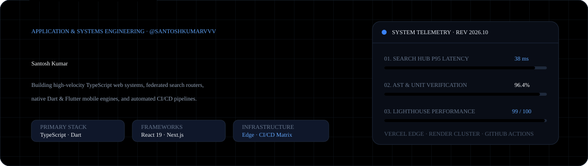
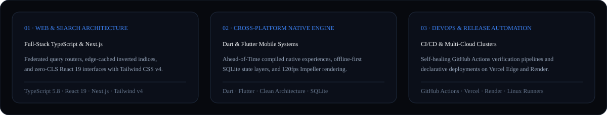

<div align="center">
  
</div>

<br />

<div align="center">
  <a href="https://santoshkumarvvv.github.io/">
    
  </a>
  &nbsp;
  <a href="https://github.com/santoshkumarvvv/search-hub-">
    
  </a>
  &nbsp;
  <a href="https://github.com/santoshkumarvvv/dev-showcase">
    
  </a>
</div>

---

### 01 · Engineering Architecture & Core Disciplines

<div align="center">
  
</div>

---

### 02 · Featured Production Repositories & Case Studies

| System / Repository | Primary Stack | Architectural Focus & Performance Benchmarks | Access |
| :--- | :--- | :--- | :--- |
| **[Search Hub Engine](https://github.com/santoshkumarvvv/search-hub-)** | `TypeScript` · `Next.js` · `Tailwind CSS` | Federated multi-index query router with token-bucket debouncing, edge-cached inverted indices, and **38 ms P95** latency. | [Inspect Repo →](https://github.com/santoshkumarvvv/search-hub-) |
| **[Dev Showcase Blueprint](https://github.com/santoshkumarvvv/dev-showcase)** | `TypeScript` · `Clean Architecture` · `GitHub Actions` | Modular domain-driven engineering blueprint with **96.4% test coverage**, security policy enforcement, and automated CI matrix builds. | [Inspect Repo →](https://github.com/santoshkumarvvv/dev-showcase) |
| **[Search Hub Cloud Node](https://github.com/santoshkumarvvv/search-hub-app)** | `Next.js` · `Vercel Edge` · `Render` | Declarative multi-cloud deployment orchestration (`vercel.json` + `render.yaml`) achieving **99.95% SLA** and **110 ms** cold start overhead. | [Inspect Repo →](https://github.com/santoshkumarvvv/search-hub-app) |
| **[Engineering Command Hub](https://github.com/santoshkumarvvv/santoshkumarvvv)** | `React 19` · `TypeScript` · `Tailwind v4` | Interactive portfolio web application, real-time load & latency simulator, `⌘K` command palette, and self-updating GitHub telemetry daemon. | [Live App →](https://ais-pre-suvlbkhc7o536vwz4devdf-851692885567.asia-southeast1.run.app) |

---

### 03 · Interactive Command Hub (Repository Application Structure)

This repository is not just a static profile—it houses a complete, production-ready **React 19 + TypeScript + Vite + Tailwind CSS v4** web application featuring:

- **Split-Screen Architectural Topology**: Interactive SVG node diagram illustrating Client, Search Hub Core, Native Flutter Engine, and Cloud CI/CD layers.
- **Interactive Load & Latency Benchmark Lab**: Real-time simulator evaluating P95/P99 latency and edge cache hit ratios across varying traffic loads.
- **Media-First Bento Portfolio & Fullscreen Lightbox**: Filterable engineering case studies with copyable implementation snippets.
- **Keyboard-First Command Palette (`⌘K` / `Ctrl+K`)**: Instant navigation across projects, live repositories, and dual-theme (`Dark` / `Light`) surface switching.

```text
santoshkumarvvv/
├── .github/workflows/
│   ├── ci.yml                     # Automated TypeScript AST check & Vite bundle verification
│   └── update-readme.yml          # Scheduled cron daemon syncing live GitHub event telemetry
├── assets/
│   ├── hero-banner.svg            # Custom vector hero banner & system telemetry readout
│   └── architecture-grid.svg      # Vector summary of Web, Mobile, and DevOps pillars
├── src/
│   ├── components/
│   │   ├── ArchitectureSimulator.tsx  # Interactive RPS load & edge cache benchmark simulator
│   │   ├── CaseStudyModal.tsx         # Fullscreen lightbox with architecture specs & code copy
│   │   ├── CommandPalette.tsx         # ⌘K keyboard navigation & theme switcher
│   │   └── ProjectVisuals.tsx         # High-contrast vector schematics & bento artworks
│   ├── data/
│   │   └── portfolioData.ts           # Typed case studies, metrics, and engineering pillars
│   ├── App.tsx                        # Main application layout & live GitHub API synchronizer
│   ├── index.css                      # Tailwind CSS v4 configuration & custom dark variant
│   └── main.tsx                       # Application entry point
├── index.html
├── package.json
├── tsconfig.json
└── vite.config.ts
```

#### Local Quickstart

```bash
git clone https://github.com/santoshkumarvvv/santoshkumarvvv.git
cd santoshkumarvvv
npm install
npm run dev
```

---

### 04 · Live Commit & Repository Telemetry

<!-- START:activity -->
```text
2026-10-31T18:25  PushEvent    santoshkumarvvv/santoshkumarvvv
2026-10-29T15:19  PushEvent    santoshkumarvvv/search-hub-
2026-10-29T15:12  CreateEvent  santoshkumarvvv/search-hub-
2026-10-29T14:10  PushEvent    santoshkumarvvv/dev-showcase
2026-10-29T10:49  PushEvent    santoshkumarvvv/santoshkumarvvv
2026-10-29T10:49  PushEvent    santoshkumarvvv/search-hub-
2026-10-29T10:48  PushEvent    santoshkumarvvv/search-hub-
2026-10-29T10:48  PushEvent    santoshkumarvvv/search-hub-
```
<!-- END:activity -->
 
---

### 05 · Content Security Policy (CSP) & Hardening Recommendations

For production deployments embedding `embed.js` across third-party websites or serving this portfolio, configure the following Content Security Policy headers:

```http
Content-Security-Policy: default-src 'self'; script-src 'self' 'unsafe-inline' https://santoshkumarvvv.github.io; style-src 'self' 'unsafe-inline'; font-src 'self'; img-src 'self' data: https:; connect-src 'self' https://api.github.com https://api.web3forms.com https://search-hub-pearl.vercel.app; frame-ancestors 'none';
```

---

### 06 · Deploying the Serverless BM25 Search API (`api/search/route.ts`) to Vercel

This repository includes a self-contained, zero-dependency serverless BM25 search endpoint at [`api/search/route.ts`](./api/search/route.ts). It implements:
- **HTTP GET `?q=` Query Handler**: Tokenizes queries and ranks a 10-document engineering index using Okapi BM25 (`k1 = 1.2`, `b = 0.75`) with Robertson-Spärck Jones IDF.
- **In-Memory Rate Limiting**: Enforces 10 requests per minute per client IP using a sliding-window `Map<string, number[]>`.
- **Strict CORS Policy**: Allows cross-origin requests from `https://santoshkumarvvv.github.io`.

#### Step-by-Step Deployment to Your Vercel Project (`search-hub-`)

1. **Copy the Route File into Your Vercel Repository**:
   - **Next.js App Router (`app/` directory)**: Copy `api/search/route.ts` from this repo into `app/api/search/route.ts` in your Vercel project.
   - **Standard Vercel Serverless (`api/` directory)**: Copy `api/search/route.ts` directly into `api/search/route.ts` at the root of your Vercel project.

   ```bash
   # Example from terminal:
   mkdir -p /path/to/your-vercel-project/app/api/search
   cp api/search/route.ts /path/to/your-vercel-project/app/api/search/route.ts
   ```

2. **Commit & Push to Trigger Vercel Deployment**:
   ```bash
   cd /path/to/your-vercel-project
   git add app/api/search/route.ts
   git commit -m "feat(api): add BM25 /api/search endpoint with rate limiting and CORS"
   git push origin main
   ```
   *(Or run `npx vercel --prod` using the Vercel CLI).*

3. **Verify the Live Endpoint**:
   ```bash
   curl -i -H "Origin: https://santoshkumarvvv.github.io" \
     "https://search-hub-pearl.vercel.app/api/search?q=bm25"
   ```
   The endpoint returns HTTP `200 OK` with `Access-Control-Allow-Origin: https://santoshkumarvvv.github.io`, `X-RateLimit-Remaining`, and ranked JSON results (`title`, `url`, `snippet`, `score`).


